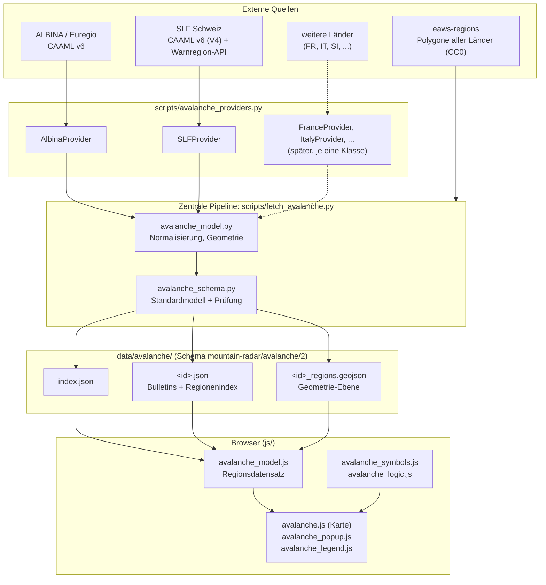
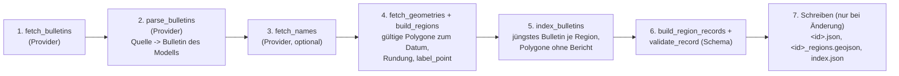
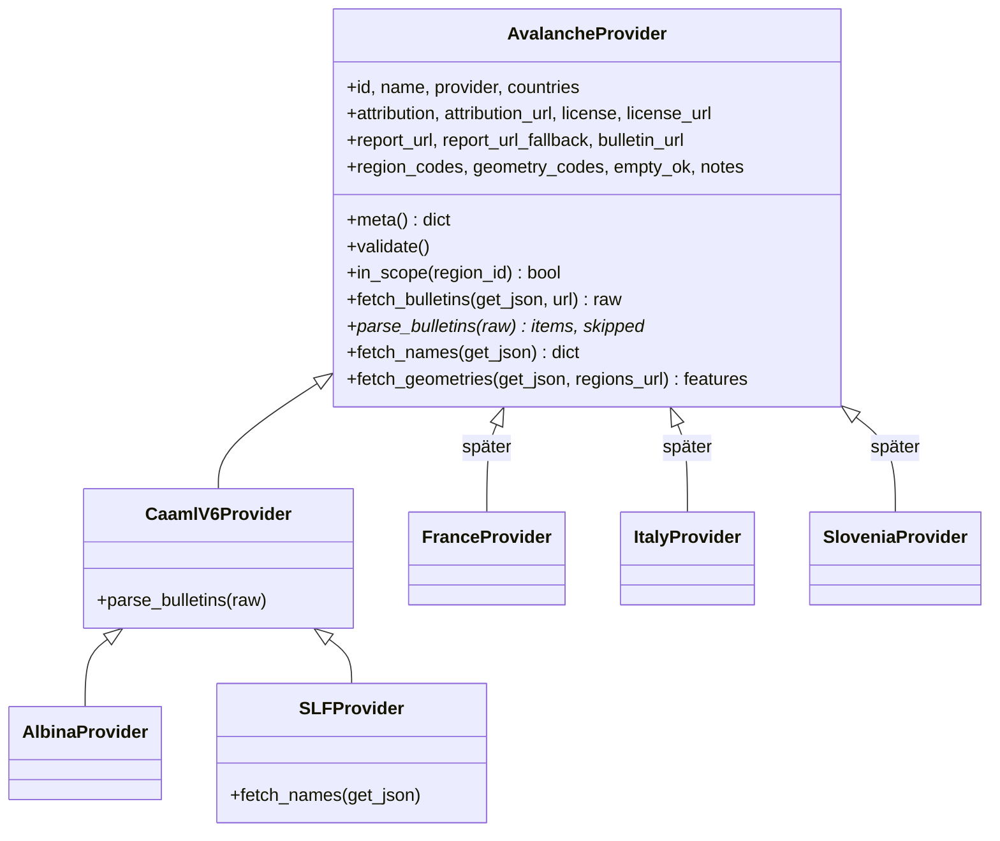

# Lawinen-Framework (Mountain Radar): Architektur

> Stand: Oktober 2026
>
> Dieses Dokument beschreibt das gemeinsame technische Gerüst aller Lawinenquellen: Datenquellen, Datenfluss, Provider, Datenmodell, GeoJSON-Schema, Frontend und Erweiterung um neue Länder. Wer es gelesen hat, kann einen weiteren Provider implementieren (Abschnitt 8).
>
> Fachliche Grundlagen, Befunde an echten Daten und Entscheidungen zur Darstellung: [LAWINENLAGE_ANALYSE.md](LAWINENLAGE_ANALYSE.md). Quellen und Lizenzen: [DATENQUELLEN.md](DATENQUELLEN.md). Status: [ROADMAP.md](ROADMAP.md).

---

# 1. Überblick und Grundsätze



Grundsätze:

1. **Ein Modell, viele Quellen.** Jede Quelle wird auf dasselbe Modell normalisiert. Pipeline, Dateien und Frontend kennen nur dieses Modell.
2. **Eine Klasse je Land.** Alles Quellenspezifische (Adresse, Format, Namen, Lizenz) steht in genau einer Provider-Klasse. Alles Übrige ist gemeinsam.
3. **Das Frontend kennt keine Quelle.** Es gibt keine Verzweigung nach Quelle oder Land. Unterschiede zwischen Ländern entstehen allein dadurch, welche Felder des Datensatzes gefüllt sind. Ein Test prüft das (Abschnitt 11).
4. **Werte der Quelle bleiben unverändert** (nur Umbenennung auf snake_case). Abgeleitet werden nur `max_level`, `max_subdivision`, `danger_by_elevation`, `elevation_thresholds`, `aspects` und `label_point`. Fehlende Angaben bleiben fehlend, nichts wird erfunden.
5. **Fehler sind laut, Daten bleiben stabil.** Ein Provider, der gegen das Schema verstößt, bricht nur seine Quelle ab. Deren Dateien bleiben unverändert, die übrigen Quellen werden geschrieben, der Lauf endet mit Fehler.
6. **Der Browser fragt die Warndienste nie direkt ab.** Das SLF verlangt das für seine Schnittstellen. Alles läuft über die GitHub Action.

---

# 2. Datenquellen

| Quelle | Provider | Format | Region | Lizenz |
|---|---|---|---|---|
| Euregio-Lawinenreport (ALBINA): Tirol, Südtirol, Trentino | `AlbinaProvider` (`euregio`) | CAAML v6, eine Datei mit allen Bulletins | Mikroregion `AT-07-14-01`, `IT-32-BZ-08-03` | CC BY 4.0 |
| SLF Lawinenbulletin Schweiz | `SLFProvider` (`slf`) | CAAML v6, V4 | Warnregion `CH-1111` | CC BY 4.0 |
| Polygone aller Länder | in jedem Provider (Standard) | GeoJSON, [eaws-regions](https://gitlab.com/eaws/eaws-regions) | `id` = EAWS-Kennung | CC0 1.0 |

Adressen, Befunde und Lizenzpflichten je Quelle: [LAWINENLAGE_ANALYSE.md](LAWINENLAGE_ANALYSE.md) Abschnitte 1, 2 und 8 sowie [DATENQUELLEN.md](DATENQUELLEN.md). Namensnennung und Lizenz sind Pflichtangaben jedes Providers (`validate()` prüft das) und erscheinen im Popup, in der Legende und in der Kartenquellenangabe.

---

# 3. Datenfluss



Schritte 1 bis 3 sind quellenspezifisch (Provider), 4 bis 7 sind für jede Quelle identisch (`fetch_source` in `scripts/fetch_avalanche.py`).

| Schritt | Modul | Was passiert |
|---|---|---|
| 1 Abruf | Provider, `get_json` der Pipeline | Der Provider nennt die Adresse, die Pipeline ruft ab (4 Versuche, Pause von 0,5 s zwischen Abfragen beim selben Dienst, Nutzer-Agent mit Projektadresse). Ein Provider ruft das Netz nie selbst. |
| 2 Übersetzung | Provider, `avalanche_model.py` | Rohdokument -> Liste von *Items* `{bulletin, regions, date}` im Modell. CAAML-Quellen nutzen `parse_caaml`, andere Quellen `make_bulletin`. |
| 3 Namen | Provider | Namen für Regionen ohne Bericht (SLF: Warnregion-API). Ein Ausfall ist kein Fehler, das Popup zeigt dann die Kennung. |
| 4 Geometrie | `build_regions` | Polygon gilt, wenn `start_date <= Datum < end_date`. Koordinaten auf 5 Stellen gerundet, entartete Ringe entfernt, Land aus der Kennung, `label_point` als Pol der Unzugänglichkeit. |
| 5 Index | `index_bulletins` | Kommt eine Region in zwei Bulletins vor, gilt das jüngere. Bei gleichem Veröffentlichungszeitpunkt bricht die Quelle ab. Regionen ohne Polygon werden gemeldet und nicht dargestellt. |
| 6 Standardmodell | `avalanche_schema.py` | Je Region ein Datensatz (Abschnitt 5). `validate_record` prüft Schlüssel, Typen und Wertebereiche. Ein Verstoß bricht die Quelle ab, bevor etwas geschrieben wird. |
| 7 Schreiben | `write_if_changed` | Nur bei neuem Inhalt, die Bulletin-Datei zusätzlich nach spätestens 7 Tagen (Heartbeat). Atomar über eine temporäre Datei. |

Aktualisierung: GitHub Action `Lawinenlage aktualisieren` (`.github/workflows/update-avalanche.yml`), täglich 07:20 und 16:20 UTC und manuell. Sie führt zuerst alle Python-Tests aus. Lokal: `python3 scripts/fetch_avalanche.py [euregio|slf]`.

---

# 4. Provider-Konzept

Ein Provider ist eine Klasse in `scripts/avalanche_providers.py`, abgeleitet von `AvalancheProvider`. Die Registry `scripts/avalanche_sources.py` führt die Instanzen (`PROVIDERS`).



`*` Pflicht. Alles andere hat eine Standardimplementierung.

## 4.1 Vertrag

| Teil | Pflicht | Bedeutung |
|---|---|---|
| Metadaten `id`, `name`, `provider`, `countries`, `attribution`, `attribution_url`, `license`, `license_url`, `report_url`, `report_url_fallback`, `bulletin_url`, `region_codes`, `geometry_codes` | ja | Gehen als `source` in `<id>.json` und damit ins Frontend. `region_codes` sind EAWS-Präfixe der Regionen der Quelle, `geometry_codes` die Dateien in eaws-regions. Links nur mit `https`. |
| `empty_ok` | nein (`False`) | `True`: Ein Bulletin ohne Regionen ist die Saisonpause (SLF). `False`: Es ist ein Fehler (Euregio, `latest` bleibt außerhalb der Saison auf dem letzten Bericht stehen). |
| `notes` | nein | Hinweise zur Quelle für die Legende, `[{"text", "url"?, "url_label"?}]` (SLF: Bedeutung der Teilstufen). |
| `parse_bulletins(raw)` | ja | Rückgabe `(items, skipped)`. Item: `{"bulletin": Bulletin des Modells, "regions": [{"id", "name"?}], "date": "JJJJ-MM-TT"}`. Nur Regionen im Geltungsbereich (`in_scope`). |
| `fetch_bulletins(get_json, url=None)` | nein | Standard: `get_json(bulletin_url)`. Überschreiben bei mehreren Adressen oder Parametern. |
| `fetch_names(get_json)` | nein | `{region_id: Name}`, Standard leer. |
| `fetch_geometries(get_json, regions_url)` | nein | Standard: eaws-regions je `geometry_code`. |
| `in_scope(region_id)` | nein | Standard: Präfixvergleich mit `region_codes`. |

## 4.2 Zwei Wege zum Bulletin

- **CAAML v6 mit EAWS-Kennungen** (Euregio, Schweiz, wahrscheinlich weitere Dienste, die pyAvaCore-kompatibel sind): von `CaamlV6Provider` ableiten und nur Metadaten setzen. `AlbinaProvider` besteht nur aus Metadaten.
- **Anderes Format** (z. B. ein Dienst mit eigenem JSON oder XML): von `AvalancheProvider` ableiten und `parse_bulletins` schreiben. Dort entsteht je Bulletin ein Modellbulletin mit `make_bulletin(...)`. Es setzt die abgeleiteten Felder (`max_level`, `danger_by_elevation`, `elevation_thresholds`) einheitlich. Die Bausteine `danger_rating(...)`, `avalanche_problem(...)`, `blocks_from(...)` aus `avalanche_model.py` können wiederverwendet werden. Der Test `test_new_provider_runs_through_central_pipeline_without_other_changes` führt genau so einen Provider ohne CAAML durch die gesamte Pipeline.

---

# 5. Internes Datenmodell

Das Standardmodell ist der **Regionsdatensatz** (`RECORD_FIELDS` in `scripts/avalanche_schema.py`, `RECORD_FIELDS` in `js/avalanche_model.js`): ein flacher Datensatz je Region mit denselben Feldern, Typen und derselben Reihenfolge für jede Quelle. Er entsteht in Python in der Pipeline (und wird dort geprüft) und im Browser aus den geladenen Dateien (`toRecord`).

| Feld | Typ | Bedeutung |
|---|---|---|
| `source` | string | Kennung der Quelle (`euregio`, `slf`, ...) |
| `country` | string | Ländercode nach EAWS-Schema, die ersten zwei Zeichen der Kennung |
| `region_id` | string | EAWS-Regionskennung |
| `region_name` | string | Name der Region, sonst die Kennung |
| `geometry` | MultiPolygon | nur in Python und im GeoJSON, im Browser hält die Kartenebene die Geometrie |
| `label_point` | [Länge, Breite] | Position des Regionssymbols, liegt im Polygon |
| `bulletin_id` | string oder null | `null` = Region ohne Bericht |
| `publication_time`, `valid_from`, `valid_until`, `next_update` | ISO 8601 UTC oder null | Zeiten des Berichts |
| `main_date` | `JJJJ-MM-TT` oder null | Hauptdatum, nur wo die Quelle eines nennt (für Links) |
| `unscheduled` | bool | außerplanmäßiger Bericht |
| `max_level`, `max_subdivision` | 1 bis 5 oder null, `minus`/`neutral`/`plus` oder null | höchste Stufe der Region (abgeleitet) |
| `danger_ratings` | Liste | Gefahrenstufen **wie die Quelle sie liefert**: `{value, level, period, subdivision?, elevation?}`. `elevation` = `{lower_bound?, upper_bound?}`, Meter oder `"treeline"` |
| `danger_by_elevation` | Liste | Stufe nach Höhe und Tageszeit für die Anzeige (abgeleitet). `basis` = `danger_rating` oder `avalanche_problem` |
| `elevation_thresholds` | Liste | alle Höhengrenzen, Meter aufsteigend, `"treeline"` zuletzt (abgeleitet) |
| `avalanche_problems` | Liste | `{type, period, elevation?, aspects?, snowpack_stability?, frequency?, avalanche_size?, danger_rating?, comment?, core_zone_text?}` |
| `aspects` | Liste | Vereinigung der Expositionen aller Probleme, N bis NW (abgeleitet) |
| `problem_groups` | Liste | Gruppierung gleichartiger Probleme, nur wo die Quelle sie liefert |
| `danger_patterns` | Liste | Gefahrenmuster `DP1` bis `DP10`, nur wo die Quelle sie liefert |
| `highlights` | string oder null | Kernaussage, einzeilig |
| `bulletin_text` | Objekt | `{summary?, sections[], tendency[]}` als Textblöcke (`paragraph`, `heading`, `list`), nie HTML |

Regeln:

- **Alle Felder sind in jedem Datensatz vorhanden.** Fehlendes ist `null` oder leer (`[]`, `{}`), nie ein fehlender Schlüssel. Eine Region ohne Bericht hat `bulletin_id: null`, alle Zeiten `null` und leere Berichtsfelder.
- **Zeitangaben** sind ISO 8601 in UTC. Die Darstellung in Ortszeit (Europe/Vienna) ist Sache des Frontends.
- **Texte** sind Blöcke. Die Pipeline wandelt das in CAAML erlaubte HTML (`br`, `p`, `h1` bis `h6`, `ul`, `li`) in Blöcke um, alle anderen Tags entfallen. Das Frontend setzt Text, nie HTML.
- **Das Schema wird geprüft** (`validate_record`): Schlüssel, Typen, Stufen 1 bis 5, Teilstufen, Tageszeiten, Höhengrenzen, Expositionen, Textblöcke, Zusammenhang von Bericht und Zeitangaben.

## 5.1 Speicherform

Aus Gründen der Dateigröße steht ein Bulletin, das für bis zu 60 Regionen gilt, nur einmal in der Datei. Der Regionsdatensatz entsteht durch Zusammensetzen:

```text
data/avalanche/index.json              Verzeichnis der Quellen
data/avalanche/<id>.json               { schema, source{Metadaten}, generated, status, reference_date, validity_period,
                                         bulletins[], regions{ <region_id>: { name, country, bulletin: Index | null } } }
data/avalanche/<id>_regions.geojson    Geometrie-Ebene (Abschnitt 6)
```

Ein Bulletin in `bulletins[]` trägt `id`, `source`, `publication_time`, `validity_period{start,end}`, `unscheduled`, `max_level`, `max_subdivision?`, `next_update?`, `main_date?`, `danger_ratings`, `danger_by_elevation`, `elevation_thresholds`, `avalanche_problems`, `problem_groups?`, `text?` (`headline?`, `summary?`, `sections[]`, `tendency[]`), `danger_patterns?`. Zuordnung zum Regionsdatensatz: `validity_period.start/end` -> `valid_from/valid_until`, `text.headline` -> `highlights`, übriger `text` -> `bulletin_text`. Die Vollform (Python: `build_region_records`) hat knapp 1,1 MB für 134 Schweizer Regionen und ist deshalb keine Browser-Datei.

---

# 6. GeoJSON-Schema

Es gibt zwei Ebenen, beide über dieselben Property-Namen und Typen für jede Quelle (`validate_feature`):

| Ebene | Erzeugt von | Properties | Zweck |
|---|---|---|---|
| **Geometrie-Ebene** (`<id>_regions.geojson`, geschrieben) | Pipeline bei jedem Lauf, ändert sich selten | `source`, `country`, `region_id`, `region_name`, `label_point` | Karte im Browser |
| **Vollform** (`to_geojson(records)`, bei Bedarf erzeugt) | `scripts/avalanche_schema.py` | alle Felder des Regionsdatensatzes außer `geometry` (`PROPERTY_FIELDS`), `geometry` als Geometrie des Features | Auswertungen (Touren, Unfälle, KI), Tests |

Gemeinsame Regeln: `FeatureCollection` mit `schema` (`mountain-radar/avalanche/2`) und `source`, jedes Feature hat eine `MultiPolygon`-Geometrie (Länge vor Breite) und genau den Satz Properties der Ebene, kein Feature mehr oder weniger.

```json
{ "type": "Feature",
  "properties": { "source": "slf", "country": "CH", "region_id": "CH-1111",
                  "region_name": "Waadtländer Voralpen", "label_point": [6.90427, 46.45463] },
  "geometry": { "type": "MultiPolygon", "coordinates": [[[[6.89, 46.45], "..."]]] } }
```

Die Geometrie-Datei enthält bewusst keinen Berichtsinhalt: Sie ändert sich nur, wenn sich die Polygone ändern, und erzeugt keine täglichen Commits mit mehreren hundert Kilobyte.

---

# 7. Frontend

```text
js/html.js               esc() (HTML-Maskierung), ohne Abhängigkeiten
js/avalanche_symbols.js  Symbol- und Bezeichnungsmodell (rein)
js/avalanche_logic.js    Logik auf dem Regionsdatensatz (rein)
js/avalanche_model.js    toRecord(): Polygon-Properties + Bulletin -> Regionsdatensatz (rein)
js/avalanche_popup.js    popupHtml(view): dieselbe Popup-Komponente für jede Quelle (rein)
js/avalanche_legend.js   Legende, quellenunabhängig aus den Metadaten
js/avalanche.js          Karte: laden, einfärben, Regionssymbole, Popups, Höhenwahl
```

## 7.1 Gemeinsame Symbolik (`avalanche_symbols.js`)

Gefahrenstufen, Expositionen, Lawinenprobleme, Gefahrenmuster und Höhenangaben sind dort **einmal** definiert. Alle Darstellungen (Karte, Regionssymbol, Popup, Legende) lesen daraus.

| Modell | Inhalt |
|---|---|
| `DANGER_LEVELS[1..5]` | Name, Farbe, CSS-Klasse, `checkered` (Stufe 5 als Schachbrett). `dangerLevel(3)` ist für jede Quelle dasselbe Modell. |
| `levelLabel`, `ratingText`, `levelChip` | Beschriftung mit Teilstufe (`3+`), Text, Stufenfeld |
| `ASPECTS`, `aspectsLabel`, `roseSvg` | Expositionen und Piktogramm der Expositionsrose |
| `PROBLEM_TYPES`, `problemModel(type)` | Name und Piktogramm je Lawinenproblem. Unbekannte Typen erscheinen mit ihrer Kennung ohne Piktogramm. |
| `DANGER_PATTERNS`, `dangerPatternLabel` | Gefahrenmuster |
| `elevationLabel`, `elevationSvg` | Höhenangaben und Höhenpiktogramm |

Stufe 3 sieht deshalb für jede Quelle gleich aus (Farbe `#ff9900`, Klasse `av-lv3`, Text „Erheblich“). Der Test `Gefahrenstufen: ein Modell, gleiche Darstellung für jede Quelle` prüft das.

## 7.2 Popup (`avalanche_popup.js`)

`popupHtml({ record, source, status })` rendert jede Region, `record` ist der Regionsdatensatz, `source` die Metadaten der Quelle, `status` `valid`, `stale`, `expired` oder `none`. Die Komponente enthält keine Verzweigung nach Quelle. Sie zeigt einen Abschnitt, wenn die Felder dafür gefüllt sind:

| Fall | Ursache in den Daten |
|---|---|
| Zusammenfassung und Kernaussage nur bei Euregio | `bulletin_text.summary` / `highlights` nur dort gefüllt |
| Teilstufe `3+` nur bei der Schweiz | `subdivision` nur dort gefüllt |
| Abschnitt „Gefahrenstufe nach Höhe (je Lawinenproblem)“ mit Hinweis nur bei der Schweiz | `danger_by_elevation[].basis == "avalanche_problem"`, weil die Quelle Höhen nur bei den Lawinenproblemen nennt |
| Gruppen „Trockene/Nasse Lawinen“ nur bei der Schweiz | `problem_groups` nur dort gefüllt |
| Lawinengröße, Stabilität, Häufigkeit nur bei Euregio | Felder des Lawinenproblems nur dort gefüllt |
| Gefahrenmuster nur bei Euregio | `danger_patterns` nur dort gefüllt |

**Zwingende Unterschiede in der Darstellung gibt es nicht.** Alle Unterschiede sind Unterschiede der Daten (Abschnitt 10). Der Test `popupHtml: Unterschiede ergeben sich nur aus den Daten, nicht aus der Quelle` belegt es: Derselbe Berichtsinhalt unter zwei Quellen ergibt dasselbe Popup bis auf Quellenname, Namensnennung und Links.

Namensnennung, Lizenz und Link zum Lagebericht kommen aus den Metadaten der Quelle (`source` in `<id>.json`), nicht aus dem Programmcode. Ausnahme, bewusst offen: Der Seitenfuß in `index.html` nennt die Quellen von Hand.

## 7.3 Karte und Legende

`avalanche.js` lädt `index.json`, je Quelle Bulletin- und Polygon-Datei, bildet mit `toRecord` je Region den Regionsdatensatz und färbt nach `levelAtAltitude(record, Höhe)` mit dem Modell `DANGER_LEVELS`. Einzelne ausgefallene Quellen zeigen einen Hinweis, die übrigen werden dargestellt. Die Legende nimmt Namen, Lizenz, Status, Hinweise (`notes`) und die Information, ob die Höhenwahl wirkt, aus den Daten.

---

# 8. Neuen Provider anlegen

Beispiel Frankreich. Voraussetzung: Lizenz und Nutzungsbedingungen des **ursprünglichen Warndienstes** sind geklärt (siehe [LAWINENLAGE_ANALYSE.md](LAWINENLAGE_ANALYSE.md) Abschnitt 9, offen). Wegen GPL-3.0 von pyAvaCore keinen Code übernehmen, die Datenformate selbst sind frei lesbar.

1. **Quelle klären.** Adresse, Format, Lizenz, Namensnennung, Veröffentlichungszeiten, Sprache. Echte Beispieldaten sichern (Fixture, mindestens ein Tag mit Bericht).
2. **Regionen klären.** Welche EAWS-Kennungen liefert die Quelle (`FR-01`, ...)? Gibt es dafür eine Polygondatei in eaws-regions (`FR_micro-regions.geojson.json`)? Passen Kennungen von Bulletin und Polygonen zusammen (bei Slowenien nicht: `SI4` gegen `SI-10`)? Dann im Provider übersetzen, nicht in der Pipeline.
3. **Provider-Klasse schreiben** in `scripts/avalanche_providers.py`:

   ```python
   class FranceProvider(AvalancheProvider):          # CAAML-Dienst: CaamlV6Provider
       id = "france"
       name = "Météo-France Bulletin d'estimation du risque d'avalanche"
       provider = "Météo-France"
       countries = ["FR"]
       attribution = "Météo-France"                  # laut Lizenz des Dienstes
       attribution_url = "https://meteofrance.com/meteo-montagne"
       license = "..."                               # Pflicht: aus den Bedingungen übernehmen
       license_url = "https://..."
       report_url = report_url_fallback = "https://meteofrance.com/meteo-montagne"
       bulletin_url = "https://..."                  # Adresse der Rohdaten
       region_codes = ("FR",)
       geometry_codes = ("FR",)
       empty_ok = True                               # Saisonpause erlaubt?

       def parse_bulletins(self, raw):               # nur bei Formaten ohne CAAML Pflicht
           items = []
           for massif in raw["massifs"]:
               ratings = [m.danger_rating({"mainValue": massif["risque"]})]   # "low".."very_high"
               bulletin = m.make_bulletin(self.id, massif["id"], raw["publication"], raw["debut"], raw["fin"],
                                          ratings, problems=[...])
               items.append({"bulletin": bulletin, "regions": [{"id": massif["code"], "name": massif["nom"]}],
                             "date": raw["debut"][:10]})
           return items, 0
   ```

   Das ist eine Skizze, die Felder des Quellformats sind erfunden und nicht gegen den echten Dienst geprüft. Gefahrenstufen kommen als CAAML-Werte (`low`, `moderate`, `considerable`, `high`, `very_high`, `no_snow`, `no_rating`) mit Höhe als `{"lowerBound": ...}` in `danger_rating()`. Lawinenprobleme mit `avalanche_problem()` oder als Dict nach Abschnitt 5.
4. **Registrieren** in `scripts/avalanche_sources.py`: eine Zeile `FranceProvider()` in `PROVIDERS`.
5. **Prüfen** mit `python3 scripts/fetch_avalanche.py france`. Die Pipeline meldet Regionen ohne Polygon, Schemaverstöße und Mehrfachbulletins. Zum Test mit früheren Berichten: Umgebungsvariablen `AVALANCHE_URL_FRANCE` und `AVALANCHE_DATA_DIR`.
6. **Tests ergänzen** (`scripts/test_avalanche_framework.py` nach dem Muster von `FranceLikeProvider`): Fixture mit echtem Bericht, Abbildung auf das Modell, Schema, Region ohne Bericht.
7. **Frontend:** keine Änderung. `index.json` führt die Quelle auf, Popup, Legende, Namensnennung, Stufen und Symbole kommen aus den Daten. Kennt die Quelle ein Lawinenproblem, das in `PROBLEM_TYPES` fehlt, erscheint es mit der Kennung. Dann `PROBLEM_TYPES` (und gegebenenfalls ein Piktogramm) ergänzen, das ist die einzige Frontend-Stelle für neue Begriffe.
8. **Dokumentation:** [DATENQUELLEN.md](DATENQUELLEN.md) (Quelle, Lizenz), Abschnitt 10 dieses Dokuments (Unterschiede), [ROADMAP.md](ROADMAP.md), README. Der Seitenfuß in `index.html` nennt die Quelle von Hand.

Aufwand je Land bei einem CAAML-Dienst: Metadaten und Test, bei einem anderen Format zusätzlich `parse_bulletins`.

---

# 9. Weitere Länder

Quellenlage und Empfehlungen: [LAWINENLAGE_ANALYSE.md](LAWINENLAGE_ANALYSE.md) Abschnitt 9. Hier die Einordnung ins Framework. Nichts davon ist umgesetzt.

| Land | Quelle (Kandidat) | Weg im Framework | Offen |
|---|---|---|---|
| Frankreich | Météo-France BRA je Massiv (35 Polygone `FR-01`...) | `FranceProvider(AvalancheProvider)` mit eigenem `parse_bulletins`. Stufen mit Höhe, Lawinenprobleme, Expositionen sind im Modell vorgesehen. | Lizenz, Format, Kennungen der Massive gegen eaws-regions |
| Italien (außerhalb der Euregio) | AINEVA-Bulletins je Region, Meteomont (`IT-34`, `IT-MeteoMont`) | `ItalyProvider`, je nach Dienst mehrere Adressen: `fetch_bulletins` überschreiben und Rohdokumente zusammenführen. Euregio-Regionen (`IT-32-BZ`, `IT-32-TN`) bleiben beim `AlbinaProvider`. | Lizenz, ein Provider für mehrere Regionaldienste oder je ein Provider je Dienst |
| Slowenien | ARSO (Quelle slowenisch) | `SloveniaProvider`. Kennungen der Polygone (`SI4`) und der `ratings.json` (`SI-10`) vorher abgleichen. | Lizenz, Sprache, Kennungen |
| Österreich, übrige Bundesländer | EUREGIO-Datei enthält teils Kärnten (`AT-02`) | `region_codes` des `AlbinaProvider` erweitern oder eigener Provider, `geometry_codes` ergänzen | Quelle der übrigen Länder prüfen |

**Schrittweiser Einstieg** (Empfehlung der Analyse): Zuerst nur Gefahrenstufen je Region aus `https://static.avalanche.report/eaws_bulletins/{Datum}/{Datum}.ratings.json` (höchste Stufe je EAWS-Region für viele Länder). Das ergibt ein Modellbulletin nur mit `danger_ratings` (Stufe, sonst nichts). Das Popup zeigt dann ehrlich nur Stufe und Link, weil alle übrigen Felder leer sind. Vollständige Bulletins folgen je Land als eigener Provider. Voraussetzung bleibt die Lizenzklärung beim ursprünglichen Warndienst.

Mehrsprachige Quellen: Das Modell enthält Texte einer Sprache je Quelle. Eine Sprachwahl braucht je Sprache eine Datei oder ein Feld `lang` (offen).

---

# 10. Bekannte Unterschiede zwischen Ländern

Vollständige Tabelle mit Befunden: [LAWINENLAGE_ANALYSE.md](LAWINENLAGE_ANALYSE.md) Abschnitt 3. Auswirkung im Framework:

| Thema | Euregio | Schweiz | Behandlung im Modell |
|---|---|---|---|
| Regionskennung | `AT-07-14-01`, `IT-32-BZ-08-03` | `CH-1111` | `country` = erste zwei Zeichen der EAWS-Kennung |
| Regionsmodell | Mikroregionen (90) | Warnregionen (149), 13 ohne Bericht | gleiche Polygone aus eaws-regions, Regionen ohne Bericht bleiben sichtbar |
| Höhe bei Gefahrenstufen | ja | nein | `danger_ratings[].elevation` nur wo vorhanden, sonst `danger_by_elevation` aus den Lawinenproblemen (`basis`) |
| Teilstufen | nein | ja (`-`, `=`, `+`) | `subdivision`, `max_subdivision` |
| Größe, Stabilität, Häufigkeit | ja | nein | Felder des Lawinenproblems, optional |
| Zusammenfassung | ja | nein | `bulletin_text.summary`, `highlights` |
| Gefahrenmuster | ja (Tirol) | nein | `danger_patterns` |
| Problemgruppen | nein | ja | `problem_groups` |
| Hauptdatum | ja (`customData.ALBINA.mainDate`) | nein | `main_date`, Platzhalter `{main_date}` in `report_url` |
| Außerplanmäßige Berichte | ja | in der Stichprobe nie | `unscheduled` |
| Saison | `latest` bleibt auf dem letzten Bericht | leeres Bulletin | `empty_ok` je Provider |
| Namen der Regionen | im Bulletin | im Bulletin und in der Warnregion-API | `fetch_names` |
| Nutzungsbedingungen | Open Data | Schnittstelle nicht für direkte Abfragen gedacht | Browser ruft nie direkt ab, Pause zwischen Abfragen |

---

# 11. Tests

| Test | Inhalt |
|---|---|
| `python3 scripts/test_avalanche_model.py` | Normalisierung, Höhenableitung, Texte, Index, Geometrie |
| `python3 scripts/test_fetch_avalanche.py` | Pipeline mit simuliertem Netzwerk: Saisonpause, Idempotenz, Ausfall einer Quelle, Heartbeat, Registry |
| `python3 scripts/test_avalanche_framework.py` | Standardmodell (Euregio und SLF identisch), GeoJSON-Schema, Prüfung von Abweichungen, **neuer Provider ohne CAAML durch die ganze Pipeline**, Schemaverstoß bricht die Quelle ab |
| `python3 scripts/run_js_tests.py` (Chrome oder Edge) | `test_avalanche_logic.html`: Logik. `test_avalanche_frontend.html`: Regionsdatensatz beider Quellen, dieselbe Popup-Komponente, gemeinsame Symbolik, echte Dateien aus `data/avalanche/`, **kein Verweis auf eine Quelle oder ein Land im Quellcode der Lawinenmodule** |

Die Python-Tests laufen in der GitHub Action vor jedem Abruf. Die Browsertests brauchen einen Browser und laufen lokal.

---

# 12. Zukunftsfähigkeit

Nichts davon ist umgesetzt. Das Framework ist so geschnitten, dass es ohne Umbau ergänzt werden kann.

| Thema | Wie es sich einfügt |
|---|---|
| **Mehrere Gefahrenstufen nach Höhe** | Bereits modelliert: `danger_ratings[].elevation` (untere/obere Grenze, Meter oder Waldgrenze), `elevation_thresholds`, `danger_by_elevation`. Eine Höhenwahl (`levelAtAltitude`) gibt es schon. Eine echte Teilung der Polygone (Geländemodell, Idee in [IDEENSAMMLUNG.md](IDEENSAMMLUNG.md)) wäre ein weiterer Verarbeitungsschritt zwischen Schritt 4 und 6, der aus `elevation_thresholds` Teilgeometrien erzeugt, ohne Provider und Frontend zu ändern. |
| **Unterschiedliche Regionenmodelle** | Der Provider nennt Kennungen und `geometry_codes`. Quellen mit eigener Geometrie (nicht in eaws-regions) überschreiben `fetch_geometries`, solange das Ergebnis EAWS-Features mit `id` liefert. Gruppierte Regionen (ein Bericht für viele Polygone) sind bereits der Normalfall (`regions[id].bulletin`). |
| **Historische Lawinenlage** | Der Datensatz trägt `valid_from`/`valid_until`/`publication_time`. Beide Quellen haben ein Archiv (SLF: `?activeAt=`, ALBINA: `bulletins/{Datum}/...`). Ansatz: `fetch_bulletins` bekommt einen optionalen Zeitpunkt, die Pipeline schreibt in `data/avalanche/archive/<id>/<Datum>.json` im selben Format, ein Datensatz je Region und Tag ergibt sich unverändert. Das Frontend lädt je Datum dieselben Dateien. Bis dahin: `AVALANCHE_URL_<ID>` und `AVALANCHE_DATA_DIR` erlauben das schon lokal. |
| **Lawinenunfälle** | Eigene Datenfamilie nach demselben Muster: `AccidentProvider` -> Standardmodell (`accident_id`, Zeit, Ort, `country`, Typ, Quelle, Lizenz) -> GeoJSON mit `Point`-Features -> eigene Ebene im Layer-Bedienfeld. Die Verbindung zur Lawinenlage läuft über den Ort (Punkt im Polygon einer `<id>_regions.geojson`) und die Zeit (Bericht, der zum Unfallzeitpunkt galt, aus dem Archiv). Das Provider-Muster, Schema-Prüfung und Quellenangabe lassen sich übernehmen. Lizenzen der Unfalldaten sind vorher zu klären ([DATENQUELLEN.md](DATENQUELLEN.md)). |
| **Risikobewertung** | Reine Funktionen auf dem Regionsdatensatz (wie `levelAtAltitude`), ohne Kenntnis der Quelle, z. B. `risk(record, Höhe, Exposition)`: Passen Höhe und Exposition zu einem Lawinenproblem (`avalanche_problems[].elevation/aspects`) und wie hoch ist dessen Stufe? Alle Eingaben sind Standardfelder. Die Ergebnisse gehören in eine eigene Schicht, nicht in die Bulletin-Dateien (Werte der Quelle bleiben unverändert). |
| **GPX-Tourenanalyse** | Für jeden Trackpunkt: Region über Punkt-im-Polygon in der Geometrie-Ebene (`region_id`), Höhe und Exposition aus Track und Gelände, Gefahrenstufe und Lawinenprobleme über den Regionsdatensatz. Weil jede Quelle denselben Datensatz liefert, braucht die Tourenanalyse keinen Länder-Code. Die Logik in `avalanche_logic.js` ist rein und ohne DOM wiederverwendbar. |
| **KI-Auswertung** | Der Regionsdatensatz ist flach, stabil benannt und enthält Texte als Blöcke: eine direkte, quellenunabhängige Eingabe für ein Sprachmodell (`danger_ratings`, `avalanche_problems`, `highlights`, `bulletin_text`). Die KI erklärt vorhandene Daten und erzeugt keine eigenen (Grundsatz der [ROADMAP.md](ROADMAP.md)). Die Vollform des GeoJSON (`to_geojson`) liefert genau diese Struktur. |

---

# 13. Entscheidungen und Grenzen

- **Evolutionär statt Neubau.** Euregio und Schweiz laufen mit unveränderten Daten weiter: Die Bulletin-Dateien wurden vor und nach dem Umbau an echten Daten verglichen und sind inhaltlich identisch (nur `schema` und die neuen Felder `notes`). Die Polygon-Dateien haben dieselbe Geometrie, die Properties heißen jetzt einheitlich (`region_id` statt `id`, dazu `source` und `region_name`).
- **Schemaversion 2.** `mountain-radar/avalanche/2` löst `/1` ab (Property-Namen der Geometrie-Ebene, `main_date` im Datensatz). Das Frontend prüft die Version nicht, Dateien und Frontend werden gemeinsam ausgeliefert.
- **Zwei Ebenen im GeoJSON** statt eines vollständigen Features je Region: kleine, selten wechselnde Geometrie-Datei, Berichte getrennt (Abschnitt 6).
- **Eingabeformat der Items.** `parse_bulletins` liefert Modellbulletins, nicht CAAML. Dadurch braucht ein Dienst ohne CAAML keinen Umweg über ein Zwischenformat.
- **Grenzen:** Ein Provider je Quelle mit einer Sprache. Der Seitenfuß in `index.html` nennt die Quellen von Hand. Neue Begriffe (Lawinenprobleme, Gefahrenmuster) einer neuen Quelle müssen in `avalanche_symbols.js` ergänzt werden. Ein Test mit aktuellen Berichten steht bis zum Saisonstart 2026/27 aus (siehe [LAWINENLAGE_ANALYSE.md](LAWINENLAGE_ANALYSE.md) Abschnitt 11).
