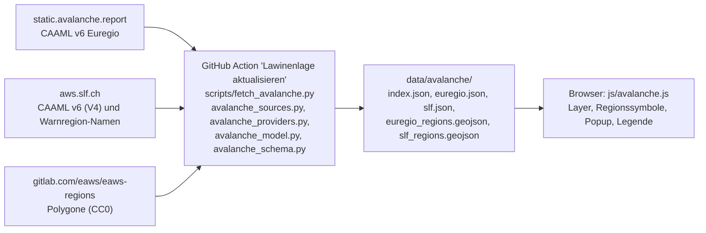

# Lawinenlage (Euregio, Schweiz): Analyse, Entscheidungen und gemeinsames Datenmodell

> Stand: Oktober 2026
>
> Dieses Dokument hält fest, was die Datenquellen tatsächlich liefern, welche Entscheidungen daraus folgen und wie die Daten im Projekt fließen. Aussagen sind als **verifiziert** (an echten Daten geprüft), **abgeleitet** (aus dem Quelltext oder der Dokumentation der Anbieter) oder **offen** gekennzeichnet.
>
> Zugehörige Dokumente: [AVALANCHE_ARCHITECTURE.md](AVALANCHE_ARCHITECTURE.md) (Framework: Provider, Datenmodell, GeoJSON-Schema, Erweiterung), [DATENQUELLEN.md](DATENQUELLEN.md) (Quellen, Lizenzen), [ROADMAP.md](ROADMAP.md) (Status).
>
> **Hinweis:** Die technische Beschreibung des Datenmodells und der Pipeline steht seit dem Framework-Umbau in [AVALANCHE_ARCHITECTURE.md](AVALANCHE_ARCHITECTURE.md) und ist dort maßgeblich. Die Abschnitte 6, 7 und 9.3 dieses Dokuments sind entsprechend nachgeführt. Dieses Dokument bleibt die Quelle für Befunde an den Daten und Entscheidungen zur Darstellung.

---

# Ergebnis in Kürze

- Umfang: **Euregio** (Tirol, Südtirol, Trentino, 90 Regionen) und **Schweiz** (SLF, 149 Warnregionen, davon 119 bis 135 mit Bericht je nach Tag).
- Beide Dienste liefern CAAML v6 nach dem EAWS-Schema. Alle Quellen werden auf **ein gemeinsames Datenmodell** abgebildet, Frontend und Pipeline kennen nur dieses Modell. Ein neues Land ist eine Provider-Klasse in `scripts/avalanche_providers.py` und eine Zeile in `scripts/avalanche_sources.py`.
- Die Geometrie kommt für alle Länder aus [eaws-regions](https://gitlab.com/eaws/eaws-regions). Die Polygone der Schweiz dort sind **identisch** mit der Warnregion-API des SLF (149 von 149 Polygonen, gleiche Kennungen `CH-<sector_id>`).
- **Höhe:** Euregio nennt Höhengrenzen bei den Gefahrenstufen, **SLF nicht** (in 71 von 71 Stufen keine Höhe). Beim SLF steht die Höhe nur bei den Lawinenproblemen, jedes Problem hat dort eine eigene Gefahrenstufe. Eine echte Teilung der Polygone ist bei keiner Quelle möglich. Die Karte färbt nach der **höchsten Stufe**, das Popup zeigt die höhenabhängigen Stufen (Euregio: aus den Gefahrenstufen, Schweiz: aus den Lawinenproblemen, jeweils mit Herkunftshinweis).
- Abgelaufene Berichte werden nicht als Gefahrenstufe dargestellt. Aktuell ist der Euregio-Bericht der letzte des Winters 2025/26, der SLF-Dienst liefert keinen aktiven Bericht (Saisonpause).

---

# 1. Quellen und API-Endpunkte

## 1.1 Euregio (ALBINA)

| Zweck | URL | Lizenz |
|---|---|---|
| aktuelles Bulletin, CAAML v6, deutsch | `https://static.avalanche.report/bulletins/latest/EUREGIO_de_CAAMLv6.json` | CC BY 4.0 |
| Archiv | `https://static.avalanche.report/bulletins/{Datum}/{Datum}_EUREGIO_de_CAAMLv6.json` | CC BY 4.0 |
| Open-Data-Übersicht | https://lawinen.report/more/open-data | |
| Symbole, Bezeichnungen, Farben | https://gitlab.com/albina-euregio/albina-website (`public/images/pro/`, `app/i18n/caaml/de.json`, `app/css/scss/abstracts/_variables.scss`) | AGPL-3.0, Grafiklizenz offen |

Ansprechpartner laut ALBINA-README: lawine@tirol.gv.at.

## 1.2 Schweiz (SLF)

| Zweck | URL | Status |
|---|---|---|
| Bulletin, CAAML v6, **V4** (verwendet) | `https://aws.slf.ch/api/bulletin/caaml/v4/{lang}/json` | verifiziert |
| Bulletin V3 (Standardversion) | `https://aws.slf.ch/api/bulletin/caaml/{lang}/json` | verifiziert |
| Bulletin als GeoJSON (Polygone mit Bulletin je Feature) | `.../caaml/{lang}/geojson`, `.../caaml/v4/{lang}/geojson` | abgeleitet (OpenAPI) |
| frühere Bulletins | Parameter `?activeAt=<ISO-Zeitpunkt>` an den Bulletin-Endpunkten | verifiziert (Daten ab März 2025 abgerufen) |
| Liste veröffentlichter Bulletins | `/api/bulletin-list/caaml/{lang}/json` | abgeleitet |
| Vorschau unveröffentlichter Bulletins | `/api/bulletin-preview/...` | nicht verwendet |
| API-Dokumentation (OpenAPI 4.0, in der Seite eingebettet) | https://aws.slf.ch/api/bulletin/caaml | verifiziert |
| Warnregionen (verwendet für Namen) | `https://aws.slf.ch/api/warningregion/warnregionDefinition/current` | verifiziert |
| Warnregionen als GeoJSON / KML | `.../warnregionDefinition/current/geojson`, `.../current/kml`, `.../findByDate/geojson`, `.../{id}/geojson` | verifiziert (`current/geojson`), übrige abgeleitet |
| Warnregion-API-Dokumentation | https://aws.slf.ch/api/warningregion/ (Swagger UI) | verifiziert |
| Bedingungen / Datenservice | https://www.slf.ch/en/services-and-products/slf-data-service/ | verifiziert |
| Veröffentlichungszeiten | https://www.slf.ch/en/avalanche-bulletin-and-snow-situation/about-the-avalanche-bulletin/publication-times-and-validity/ | verifiziert |

Sprachen: `de`, `fr`, `it`, `en` (existiert eine Sprache nicht, liefert der Dienst deutsch). Ohne Anmeldung nutzbar. Kontakt: data@slf.ch.

**V3 gegen V4** (laut OpenAPI-Beschreibung): In V4 sind Höhengrenzen Texte statt Zahlen (wie im CAAML-Standard und bei ALBINA), der ganze Berg ist ein leeres Objekt `"elevation": {}`, und alle leeren Werte (`null`, `""`, `{}`) sind entfernt. Verwendet wird V4.

## 1.3 Geometrie

| Quelle | Inhalt | Lizenz |
|---|---|---|
| `https://gitlab.com/eaws/eaws-regions/-/raw/master/public/micro-regions/{AT-07,IT-32-BZ,IT-32-TN,CH}_micro-regions.geojson.json` | Polygone mit `id` und optional `start_date` / `end_date` | CC0 1.0 |
| SLF-Warnregion-API (s. o.) | dieselben Schweizer Polygone, dazu Namen in 4 Sprachen | CC BY 4.0 |

---

# 2. Befunde zu den Daten

## 2.1 Euregio

Stichprobe: das `latest`-Bulletin und archivierte Bulletins von 2025-03-10, 2025-12-20, 2026-01-15, 2026-02-10, 2026-03-05, 2026-03-25, 2026-04-15 und 2026-05-02 (53 Bulletins).

| Befund | Status |
|---|---|
| `latest` ist derzeit das letzte Bulletin des Winters (Text: „Dies ist die letzte Gefahrenkarte des Winters 2025/26“), `Last-Modified` 02.05.2026 | verifiziert |
| Die EUREGIO-Datei enthält teils auch Kärnten (`AT-02-...`), diese Regionen werden nicht übernommen | verifiziert |
| Alle Regionen im Bulletin haben genau ein gültiges Polygon und umgekehrt (86 bis 90 Regionen an 8 Stichtagen, 90 im aktuellen Bulletin) | verifiziert |
| Polygon-Gültigkeit steht in `start_date` / `end_date` (das README von eaws-regions nennt `valid_from` / `valid_until`). Auswahl wie in der ALBINA-Website: `start_date <= Datum < end_date` | verifiziert |
| Regionsnamen stehen nur im Bulletin (`regions[].name`) | verifiziert |
| Regelbericht um 17:00 Ortszeit des Vortags, gültig 24 Stunden. Außerplanmäßige Berichte kommen vor (`unscheduled: true`, 15.04.2026, 06:00Z) | verifiziert |
| Gefahrenstufen tragen Höhengrenzen (`lowerBound` / `upperBound`, Meter oder `treeline`) und Tageszeit (`all_day`, `earlier`, `later`). 70 von 98 Stufen haben eine Höhengrenze, 14 davon `treeline` | verifiziert |
| Beobachtet: `low`, `moderate`, `considerable`; Stufen 4 und 5 nicht (Darstellung folgt der Skala) | verifiziert / nicht beobachtet |
| Texte enthalten als HTML nur `<br/>`; `weatherForecast` / `travelAdvisory` waren immer leer; Kernaussage `highlights` und Gefahrenmuster (`customData.LWD_Tyrol.dangerPatterns`) kommen vor | verifiziert |

## 2.2 Schweiz (SLF)

Stichprobe: V4-Bulletins zu 7 Zeitpunkten (15.03.2025, 20.12.2025, 15.01., 10.02., 15.03., 20.04. und 10.05.2026), zusammen 62 Bulletins. Das aktuelle Bulletin (29.10.2026) ist leer.

| Befund | Status |
|---|---|
| Ohne aktives Bulletin liefert der Dienst `{"bulletins":[]}` (Saisonpause). Das aktuelle Bulletin war am 29.10.2026 leer | verifiziert |
| Regel-Ausgabe täglich 17 Uhr, gültig bis 17 Uhr des Folgetags; Update um 8 Uhr vor allem im Winter (bei Stufe 3 oder höher irgendwo in der Schweiz, sonst nach Lage); im Sommer und Herbst nur bei starkem Schneefall (Angabe des SLF). Beobachtet: Veröffentlichung 07:00Z (Morgen-Update, Winter), 16:00Z (Winter) bzw. 15:00Z (Sommerzeit, Abendausgabe); `nextUpdate` entspricht dem Ende der Gültigkeit | verifiziert |
| `regionID` ist `CH-<sector_id>` (z. B. `CH-1111`). Alle Regionen aller 7 Stichtage haben ein Polygon (149 Sektoren). 119 bis 135 Regionen haben je Tag einen Bericht, 13 Sektoren hatten nie einen (Jura, Mittelland) | verifiziert |
| Eine Gefahrenstufe je Region und Tageszeit (`all_day`, teils zusätzlich `later`), **in keiner der 71 Stufen eine Höhengrenze** | verifiziert |
| Teilstufen in `customData.CH.subdivision`: `minus`, `neutral`, `plus` (Schreibweise 3-, 3=, 3+). Bei 51 von 71 Stufen vorhanden, nicht bei Nassschnee. Bedeutung laut SLF: unteres Ende, Mitte, oberes Ende der Stufe, bei Trockenschneelawinen ab Stufe 2 | verifiziert |
| Lawinenprobleme tragen Höhe (`lowerBound` / `upperBound`), Expositionen, eigene Gefahrenstufe (`dangerRatingValue`, mit Teilstufe), `comment` (Beschreibung) und `customData.CH.coreZoneText` (z. B. „Gefahrenstufe „erheblich“ (3+) an West- über Nordost- bis Südosthängen über 2000m.“). 93 von 109 Problemen haben Höhe und Expositionen | verifiziert |
| Keine Lawinengröße, Stabilität oder Häufigkeit bei den Problemen | verifiziert |
| Beobachtete Problemtypen: `new_snow`, `persistent_weak_layers`, `wet_snow`, `wind_slab`, `no_distinct_avalanche_problem`, `gliding_snow` | verifiziert |
| `customData.CH.aggregation` fasst Probleme mit gleichem Inhalt zusammen (z. B. „Trockene Lawinen“: Neuschnee, Altschnee) | verifiziert |
| Texte nur als `comment` in `weatherForecast`, `weatherReview`, `snowpackStructure`, `tendency`, als **HTML** (`h1`, `h2`, `p`, `ul`, `li`, `span`, `br`). Keine Felder `avalancheActivity`, `highlights`, `travelAdvisory`, keine Zusammenfassung | verifiziert |
| `unscheduled` war in allen 62 Bulletins `false` | verifiziert |
| Das Schema nennt für das GeoJSON-Produkt ein Feld `fill` mit den Farben `#CCFF66`, `#FFFF00`, `#FF9900`, `#FF0000` und `#800000` (Stufe 5) | abgeleitet (OpenAPI) |

## 2.3 Geometrie der Schweiz

eaws-regions `CH_micro-regions` und die SLF-Warnregion-API (`current/geojson`) enthalten dieselben 149 Polygone mit denselben Kennungen (`CH-1111`, ...). Die Punktmengen sind bei 4 Nachkommastellen für alle 149 Regionen gleich (verifiziert). Die SLF-Definition ist `id` 21, gültig 01.10.2019 bis 01.10.2071. Weil dadurch alle Länder dieselbe Geometrie-Pipeline nutzen können, kommt die Geometrie aus eaws-regions, die SLF-API liefert nur die **Namen** (`sector_names.de`) für Regionen ohne Bericht.

---

# 3. Unterschiede SLF und Euregio

| Thema | Euregio (ALBINA) | Schweiz (SLF) |
|---|---|---|
| Format | CAAML v6 JSON, eine Datei mit allen Bulletins | CAAML v6 JSON (V4), aktives Bulletin zum Abrufzeitpunkt |
| Regionskennung | `AT-07-14-01`, `IT-32-BZ-08-03`, ... | `CH-1111` |
| Höhe bei den Gefahrenstufen | ja (Meter oder Waldgrenze) | **nein** |
| Höhe bei den Lawinenproblemen | ja | ja, mit eigener Gefahrenstufe je Problem |
| Teilstufen | nein | ja (`-`, `=`, `+`) |
| Lawinengröße, Stabilität, Häufigkeit | ja | nein |
| Zusammenfassung / Kernaussage | ja (`highlights`, `avalancheActivity.highlights`) | nein |
| Beschreibung der Gefahr | `avalancheActivity.comment` | Kommentar je Lawinenproblem, dazu Kernzonen-Text |
| Texte | Absätze mit `<br/>` | HTML mit Überschriften, Absätzen und Listen |
| Wetter | Vorhersage (meist leer) | Prognose und Rückblick (lang, mit Zwischenüberschriften) |
| Tendenz | Typ, Zeitraum, Text | Text |
| Hauptdatum für Verlinkung | `customData.ALBINA.mainDate` | keines |
| Außerplanmäßige Berichte | `unscheduled` kommt vor | in der Stichprobe nie |
| Saison | `latest` bleibt auf dem letzten Winterbericht stehen | leeres Bulletin ohne aktiven Bericht |
| Regionsnamen | im Bulletin | im Bulletin, für alle 149 Regionen in der Warnregion-API |
| Lizenz / Namensnennung | CC BY 4.0, Nennung der Warndienste | CC BY 4.0, deutlich sichtbarer Verweis auf das SLF mit Link auf www.slf.ch |
| Nutzungsbedingungen | Open Data | Schnittstelle nicht für direkte Abfragen aus Kundensystemen gedacht |

---
# 4. Höhenabhängige Gefahrenstufen

## 4.1 Was die Quellen liefern

**Euregio:** Je Gefahrenstufe **eine** Höhengrenze (`upperBound` = unter, `lowerBound` = über), Meter oder `treeline`, die Schwelle wechselt von Bericht zu Bericht (beobachtet 2000, 2600, 2800 m und `treeline`), zusätzlich die Tageszeit.

**SLF:** Eine Stufe je Region (und Tageszeit) ohne Höhe. Die Höhe steht bei den Lawinenproblemen, die jeweils eine eigene Stufe tragen. Typisches Beispiel aus den Daten vom 15.03.2025: Region mit Stufe 3+, Neuschnee und Altschnee „über 2200 m: Stufe 3+“, Nassschnee „unter 1800 m: Stufe 2“. Das entspricht dem Beispiel „unter 2200 m Stufe 2, darüber Stufe 3“, ist aber aus den Lawinenproblemen abgeleitet, nicht aus einer Höhenaufteilung der Region.

In beiden Fällen sind die Polygone rein zweidimensional.

## 4.2 Optionen

| Option | Bewertung |
|---|---|
| A. Vorberechnete Höhen-Polygone von ALBINA (`eaws-regions/public/micro-regions_elevation`) | nicht verwendbar: je Region ein festes Paar `low`/`high` mit **einer** Schwelle unklarer Bedeutung, von ALBINA als obsolet geführt, passt nicht zur täglich wechselnden Grenze. Für die Schweiz gibt es nichts Vergleichbares |
| B. Polygone selbst per Geländemodell an der Tagesgrenze teilen | technisch möglich (EU-DEM, CC BY 4.0), aber aufwendig; `treeline` hat keinen Wert; weder ALBINA noch SLF stellen die Stufe so dar. Als Idee in [IDEENSAMMLUNG.md](IDEENSAMMLUNG.md) |
| C. Färbung nach höchster Stufe, Aufteilung im Popup | **umgesetzt**, entspricht der offiziellen ALBINA-Karte (`micro_regions_a`, `maxDangerRatings`) und der SLF-Icon-Karte („pro Region die höchste Stufe“, Angabe auf der SLF-Produktseite) |
| D. Höhenwahl in der Legende | **umgesetzt** für Quellen, die Höhen bei den Gefahrenstufen angeben (Euregio). Für die Schweiz wirkungslos, weil die Stufen keine Höhe tragen |

## 4.3 Entscheidung

- Füllfarbe und Regionssymbol zeigen die **höchste Stufe** des Bulletins (alle Höhen, alle Tageszeiten), bei der Schweiz mit Teilstufe (`3+`).
- Das Popup zeigt „Gefahrenstufe nach Höhe“ (Feld `danger_by_elevation`): Bei Euregio sind das die Gefahrenstufen mit Höhe (Piktogramm `levels_<unten>_<oben>`). Bei der Schweiz zuerst die Stufe der Region, dann „Gefahrenstufe nach Höhe (je Lawinenproblem)“, zusammengefasst nach Höhe und Stufe, mit den beteiligten Problemen und dem Hinweis, dass die Quelle die Höhe nur bei den Lawinenproblemen nennt.
- **Waldgrenze:** Ohne Zahlenwert wird sie nicht geschätzt. Hängt das Ergebnis der Höhenwahl davon ab, gilt die höchste mögliche Stufe, die Region erhält einen gestrichelten Rand.
- **Höhenwahl:** Bei Quellen ohne Höhe in den Gefahrenstufen (SLF) bleibt die höchste Stufe, die Legende sagt das. Eine Ableitung der Stufe je Höhe aus den Lawinenproblemen wäre eine Interpretation (außerhalb der genannten Höhe ist die Stufe nicht angegeben) und unterbleibt.

## 4.4 Grenzen

- Die Farbe ist die Obergrenze der Region, nicht ein Mittelwert. In tiefen Lagen kann die Gefahr deutlich geringer sein.
- Bei der Schweiz stammen die höhenabhängigen Stufen von den Lawinenproblemen. Wo kein Problem eine Höhe nennt, ist keine Höhenaufteilung bekannt.

---

# 5. Darstellung

| Stufe | Name | Farbe | Quelle |
|---|---|---|---|
| 1 | Gering | `#ccff66` | ALBINA `_variables.scss`, SLF `fill` |
| 2 | Mäßig | `#ffff00` | ALBINA, SLF |
| 3 | Erheblich | `#ff9900` | ALBINA, SLF |
| 4 | Groß | `#ff0000` | ALBINA, SLF |
| 5 | Sehr groß | `#ff0000` mit rot-schwarzem Schachbrett | ALBINA (`bg_checkered`); der SLF-Hinweis `fill` nennt für Stufe 5 `#800000`, die einheitliche EAWS-Darstellung (Schachbrett) hat Vorrang |

- Die Farben der Europäischen Gefahrenskala bleiben bewusst unverändert und weichen von den allgemeinen Warnfarben im [STYLEGUIDE.md](STYLEGUIDE.md) ab.
- **Regionssymbol:** Ein anklickbares Symbol je Region mit Stufe (und Teilstufe) in der Stufenfarbe. Die Position ist der Pol der Unzugänglichkeit des größten Teilpolygons (der Punkt mit dem größten Abstand zum Rand, Algorithmus von Mapbox), in der Pipeline berechnet (`label_point`), damit das Symbol auch bei konkaven Regionen innerhalb liegt. Sichtbar ab Zoomstufe 9 (Regionen sind ca. 15 km groß, darunter überlagern sich die Symbole). Bei Waldgrenze ohne Wert gestrichelter Rand.
- **Popup:** Regionsname, Quelle, Stufe, Veröffentlichung, Gültigkeit, nächste Aktualisierung, Zusammenfassung (wenn die Quelle eine liefert), Gefahrenstufen nach Höhe und Tageszeit, Lawinenprobleme (Höhenbereich, Expositionen, Stufe, Stabilität, Häufigkeit, Größe, Beschreibung, Kernzonen-Text), Lawinensituation, Schneedecke, Wetter, Wetterrückblick, Tourenempfehlung, Tendenz, Gefahrenmuster, Link zum Lagebericht und Namensnennung. Texte werden als geprüfte Blöcke (Absatz, Überschrift, Liste) angezeigt, nie als HTML.
- **Abgelaufene Berichte:** Nach Ende der Gültigkeit gilt der Bericht noch 6 Stunden als „abgelaufen, neuer folgt“ (Farben bleiben, Hinweis im Popup und in der Legende). Danach werden die Regionen grau und gestrichelt ohne Stufe dargestellt, das Popup nennt nur den Ablauf. Regionen ohne Bericht (Quelle ohne aktives Bulletin, Sektoren ohne Bericht) sind ebenso grau mit Hinweis.
- **Ebene standardmäßig aus:** Die Daten laden erst beim ersten Einblenden.
- **Symbole:** Die Quellen stellen keine eigenen Icon-Downloads bereit (SLF: nur das Produkt „Icon-Karte“). Verwendet werden die EAWS-Standardpiktogramme in der ALBINA-Fassung (Gefahrenstufen `levels_<unten>_<oben>`, Lawinenprobleme, Expositionsrose und Höhenpiktogramm als SVG) für beide Länder. Die Stufenfelder zeichnet das Frontend selbst. Lizenz offen (Abschnitt 10).

---

# 6. Gemeinsames Datenmodell

Schema `mountain-radar/avalanche/2` (löste `/1` ab: einheitliche Property-Namen der Polygon-Datei, `main_date` im Regionsdatensatz). Je Quelle zwei Dateien plus ein Verzeichnis, alles in `data/avalanche/`. Das Standardmodell je Region (Regionsdatensatz, alle Felder, Typen, Regeln) und das GeoJSON-Schema beschreibt [AVALANCHE_ARCHITECTURE.md](AVALANCHE_ARCHITECTURE.md), Abschnitte 5 und 6. Hier die Speicherform:

```text
data/avalanche/index.json              Verzeichnis der Quellen für das Frontend
data/avalanche/<id>.json               Bulletins und Regionenindex der Quelle (täglich)
data/avalanche/<id>_regions.geojson    Polygone der Quelle (ändert sich selten)
```

`<id>` ist `euregio` oder `slf`. Eine Quelle ist von den anderen unabhängig: Fällt sie aus, bleiben ihre Dateien unverändert.

## 6.1 `index.json`

```json
{ "schema": "mountain-radar/avalanche/2",
  "sources": [ { "id": "slf", "bulletin_file": "slf.json", "regions_file": "slf_regions.geojson" } ] }
```

## 6.2 `<id>.json`

```json
{
  "schema": "mountain-radar/avalanche/2",
  "source": { "id": "slf", "name": "SLF Lawinenbulletin Schweiz", "provider": "WSL-Institut für Schnee- und Lawinenforschung SLF",
              "countries": ["CH"], "attribution": "...", "attribution_url": "https://www.slf.ch",
              "license": "CC BY 4.0", "license_url": "...", "report_url": "...", "report_url_fallback": "...", "bulletin_url": "...", "notes": [ "optional, Hinweise für die Legende" ] },
  "generated": "2026-10-29T10:37:56Z",
  "status": "active | no_active_bulletin",
  "reference_date": "2026-03-15",
  "validity_period": { "start": "...", "end": "..." },
  "bulletins": [ { "...": "Bulletin, siehe 6.3" } ],
  "regions": { "CH-1111": { "name": "Waadtländer Voralpen", "country": "CH", "bulletin": 4 } }
}
```

`regions[id].bulletin` ist der Index in `bulletins` oder `null` (Region ohne Bericht). Ein Bulletin gilt für viele Regionen und steht deshalb nur einmal in der Datei. `validity_period` ist `null` ohne Bulletins.

## 6.3 Bulletin

| Feld | Bedeutung |
|---|---|
| `id`, `source` | Kennung des Bulletins, Quelle |
| `publication_time`, `validity_period` `{start, end}`, `next_update?`, `main_date?`, `unscheduled` | Zeiten laut CAAML (`main_date` nur Euregio) |
| `max_level`, `max_subdivision?` | höchste Gefahrenstufe 1 bis 5 mit Teilstufe (`minus`, `neutral`, `plus`), `null` bei `no_snow`/`no_rating`. Abgeleitet |
| `danger_ratings[]` | `{ value, level, period, subdivision?, elevation? }` unverändert aus der Quelle; `elevation` = `{ lower_bound?, upper_bound? }` mit Meterzahl oder `"treeline"` |
| `danger_by_elevation[]` | Gefahrenstufe nach Höhe und Tageszeit für die Anzeige. `basis` = `danger_rating` (Quelle gibt die Höhe bei den Stufen an) oder `avalanche_problem` (Höhe nur bei den Lawinenproblemen, gleiche Kombinationen zusammengefasst, mit `problem_types`). Abgeleitet |
| `elevation_thresholds[]` | alle Höhengrenzen des Bulletins, Meter aufsteigend, `"treeline"` zuletzt. Abgeleitet |
| `avalanche_problems[]` | `{ type, period, elevation?, aspects?, snowpack_stability?, frequency?, avalanche_size?, danger_rating?, comment?, core_zone_text? }`; `aspects` in der Reihenfolge N, NE, E, SE, S, SW, W, NW; `danger_rating` = `{ value, level, subdivision? }`; `comment` als Textblöcke |
| `problem_groups[]` | `{ types, period, category?, title? }`, Probleme mit gleichem Inhalt (SLF) |
| `text` | `headline?`, `summary?`, `sections[]` (`key` = `activity`, `snowpack`, `weather_forecast`, `weather_review`, `travel_advisory`; je `highlights?`, `blocks[]`), `tendency[]` (`type?`, `validity_period?`, `highlights?`, `blocks[]`) |
| `danger_patterns[]` | Gefahrenmuster-Kennungen (Tirol-spezifisch) |

Textblöcke: `{ "type": "paragraph", "text": "..." }`, `{ "type": "heading", "level": 2, "text": "..." }`, `{ "type": "list", "items": ["..."] }`. Die Pipeline wandelt das in CAAML erlaubte HTML (`br`, `p`, `h1` bis `h6`, `ul`, `li`) in Blöcke um, alle anderen Tags entfallen, ihr Text bleibt. Fettdruck geht dabei verloren.

## 6.4 Geometrie `<id>_regions.geojson`

`FeatureCollection` mit `schema`, `source`, `geometry_source`, `geometry_license`. Je Feature `properties` = `{ "source", "country", "region_id", "region_name", "label_point": [lon, lat] }` und `MultiPolygon` (nur zum Bulletin-Datum gültige Polygone, Koordinaten auf 5 Nachkommastellen gerundet, entartete Ringe entfernt, sonst keine Vereinfachung). Dieselben Properties für jede Quelle, geprüft in der Pipeline und in den Tests.

## 6.5 Abbildung auf die geforderten Felder

| Geforderte Angabe | Ort im Modell |
|---|---|
| country | `regions[id].country` und `properties.country` (erste zwei Zeichen der EAWS-Kennung) |
| source | `source.id` der Datei und `bulletin.source`; Lizenz und Namensnennung in `source` |
| region_id | Schlüssel in `regions`, `properties.region_id` der Polygone |
| region_name | `regions[id].name`, `properties.region_name` der Polygone |
| geometry | `<id>_regions.geojson` |
| danger_ratings | `bulletin.danger_ratings` (dazu `danger_by_elevation`, `max_level`) |
| elevation_thresholds | `bulletin.elevation_thresholds` (Quelle: `danger_ratings` und `avalanche_problems`) |
| avalanche_problems | `bulletin.avalanche_problems` |
| aspects | `avalanche_problems[].aspects` |
| publication_time | `bulletin.publication_time` |
| validity_period | `bulletin.validity_period` (Datei: gesamter Zeitraum) |
| bulletin_text | `bulletin.text` (dazu die Beschreibungen in `avalanche_problems[].comment`) |

Die Aufteilung in Bulletin und Region (statt alles je Region zu wiederholen) ist eine Entscheidung zur Dateigröße: Ein Bulletin gilt für bis zu 60 Regionen. Die Zusammenführung zu einem Datensatz je Region passiert im Frontend über `regions[id].bulletin`.

## 6.6 Regeln der Pipeline

- Werte der Quelle bleiben unverändert (Umbenennung auf snake_case), fehlende Felder bleiben fehlend. Abgeleitet werden nur `max_level`, `max_subdivision`, `danger_by_elevation`, `elevation_thresholds` und `label_point`.
- Kommt eine Region in zwei Bulletins vor, gilt das jüngere; bei gleichem Veröffentlichungszeitpunkt bricht die Pipeline für diese Quelle ab. Ein Bulletin ohne Gefahrenstufen ebenso.
- Regionen im Bulletin ohne Polygon werden gemeldet und nicht dargestellt. Polygone ohne Bulletin bleiben als „kein Bericht“ sichtbar, Namen aus der Quelle (SLF: Warnregion-API).
- Ein leeres Euregio-Bulletin ist ein Fehler, ein leeres SLF-Bulletin ist die Saisonpause (`empty_ok`).

---
# 7. Datenfluss und Aktualisierung



- **Zeitplan:** täglich 07:20 UTC und 16:20 UTC, zusätzlich manuell startbar. Das SLF-Morgenupdate liegt um 8 Uhr Ortszeit (07:00Z Winterzeit), die Abendausgabe beider Dienste um 17 Uhr Ortszeit (16:00Z Winterzeit, 15:00Z Sommerzeit). Die Uhrzeiten sind eine Projektentscheidung auf Basis dieser Zeiten und der beobachteten Veröffentlichungen.
- **Der Browser fragt die Dienste nie direkt ab.** Das SLF verlangt, dass seine Schnittstellen nicht aus Kundensystemen direkt bedient werden. Die Action holt je Lauf wenige Dateien (SLF: Bulletin, Namen, Polygone) mit Pause zwischen den Abfragen.
- **Commits:** Dateien werden nur bei neuem Inhalt geschrieben, spätestens nach 7 Tagen (damit das Repository auch außerhalb der Saison aktiv bleibt).
- **Fehlerverhalten:** Fällt eine Quelle aus, bleiben ihre Dateien unverändert, die übrigen werden gespeichert, der Lauf endet mit Fehler (E-Mail von GitHub). Das Frontend zeigt Berichte nach Ablauf grau, nie veraltete Stufen als aktuell.
- **Latenz:** Zwischen Veröffentlichung und Lauf liegt etwa eine Stunde (Sommerzeit länger), die Frist „abgelaufen, neuer folgt“ (6 Stunden) deckt auch Verzögerungen der GitHub-Zeitplanung.
- **Lokal:** `python3 scripts/fetch_avalanche.py [slf|euregio]`. Zum Test mit früheren Berichten (nur Entwicklung): Umgebungsvariablen `AVALANCHE_URL_SLF` (z. B. mit `?activeAt=2026-03-15T08:00:00Z`), `AVALANCHE_URL_EUREGIO` (Archiv-URL) und `AVALANCHE_DATA_DIR`.

---

# 8. Lizenz und Namensnennung

| Quelle | Lizenz | Pflichten |
|---|---|---|
| Euregio-Lawinenreport | CC BY 4.0 | Namensnennung „Lawinenwarndienste Tirol, Südtirol und Trentino (Euregio-Lawinenreport, avalanche.report)“ |
| SLF | CC BY 4.0 | „deutlich sichtbarer Verweis auf die Datenquelle (WSL-Institut für Schnee- und Lawinenforschung SLF)“, bei digitalen Produkten als Link auf www.slf.ch (Wortlaut der Datenservice-Seite, dort englisch). Der Bericht ist eine sicherheitsrelevante Warnung des Bundes: Inhalte korrekt und aktuell halten. Keine Haftung des SLF für Fehler, Verzögerungen oder Ausfälle, kein Bereitschaftsdienst. Schnittstellen nicht überlasten |
| eaws-regions | CC0 1.0 | keine |

Die Namensnennung steht in der Legende, im Popup, in der Kartenquellenangabe und im Seitenfuß. Empfehlungen des SLF, die noch offen sind: eine Nachricht an data@slf.ch, um in die Mailingliste „Avalanche Bulletin“ (Hinweise zu Änderungen und Unterbrüchen) aufgenommen zu werden, und optional ein Link auf das Feedback-Tool des SLF (https://pro.slf.ch/reply/public/#/).

---

# 9. Weitere Länder: Empfehlungen

## 9.1 Ausgangslage

- Die ALBINA-Gruppe veröffentlicht täglich `https://static.avalanche.report/eaws_bulletins/{Datum}/{Datum}.ratings.json` (verifiziert für 15.01. und 15.03.2026) mit der **höchsten Gefahrenstufe je EAWS-Region** für viele Länder (u. a. FR, IT, SI, CH, DE, ES, NO). Schlüssel: `REGION`, `REGION:am`, `REGION:pm`, `REGION:high`, `REGION:low` und Kombinationen (z. B. `FR-01=3`, `FR-01:low=2`). Verifiziert: 35 Regionen für Frankreich, 8 für Slowenien (`SI-1`, `SI-10`, ...), 158 für Italien. Die Bedeutung von `high` und `low` ist nicht dokumentiert.
- [pyAvaCore](https://gitlab.com/albina-euregio/pyAvaCore) (GPL-3.0) wandelt Bulletins vieler Dienste in CAAML v6 und `ratings.json` um. Laut README unterstützt: Frankreich (Météo-France, meteofrance.com/meteo-montagne), Italien (AINEVA: Piemonte, Valle d'Aosta, Lombardia, Veneto, Friuli-Venezia Giulia, Marche; Bozen und Trentino über avalanche.report), Slowenien (ARSO, meteo.arso.gov.si).
- eaws-regions enthält Polygone für diese Länder (verifiziert: FR 35, SI 19, IT-34 8).
- Nicht gelungen: vollständiges CAAML für Italien und Slowenien über ALBINAs Zusatzregionen-Pfade. Die erratenen Pfade lieferten 404, die Konfiguration der ALBINA-Website nennt das Muster `/eaws_bulletins/{date}/{date}{region}{lang}.json`, die Auflösung der Platzhalter ist offen.

## 9.2 Empfehlung

1. **Quelle klären, bevor Code entsteht:** Je Land Lizenz und Nutzungsbedingungen des **ursprünglichen Warndienstes** prüfen (Météo-France, AINEVA, ARSO). Die Lizenz von avalanche.report (CC BY 4.0) gilt für ihre eigenen Daten, nicht automatisch für Daten Dritter in `ratings.json`. Das ist offen.
2. **Schritt 1, nur Gefahrenstufen:** Ein einfacher Normalisierer aus `ratings.json` (Stufe je Region, Hinweis auf den Warndienst und Link) liefert schnell Farben und Symbole für FR, IT und SI im selben Datenmodell (`danger_ratings` mit `level`, sonst nichts). Das Popup zeigt dann ehrlich nur Stufe und Link, keine Probleme oder Texte. Offen: Bedeutung von `high`/`low`/`am`/`pm`. Kennungen vor der Umsetzung abgleichen: Die Polygone für Slowenien in eaws-regions heißen z. B. `SI4`, die Schlüssel der `ratings.json` `SI-10`.
3. **Schritt 2, vollständige Bulletins:** Jedes Land bekommt eine Provider-Klasse in `scripts/avalanche_providers.py` (bei einem Dienst ohne CAAML v6 mit eigenem `parse_bulletins`, Anleitung in [AVALANCHE_ARCHITECTURE.md](AVALANCHE_ARCHITECTURE.md), Abschnitt 8). pyAvaCore zeigt, wie die Quellen aufgebaut sind. Wegen GPL-3.0 keinen Code übernehmen, ohne die Lizenz des Projekts zu klären; die Datenformate selbst sind frei lesbar.
4. **Frankreich:** BRA je Massiv (35 Polygone). **Italien:** AINEVA-Bulletins je Region sowie Meteomont (`IT-MeteoMont`, `IT-34` und weitere Polygon-Dateien in eaws-regions). **Slowenien:** ARSO (Quelle slowenisch, Sprache beachten).
5. **Sprache:** Das Datenmodell enthält Texte einer Sprache je Quelle. Für mehrsprachige Quellen (SLF liefert de, fr, it, en) entscheidet eine spätere Sprachwahl, ob je Sprache eine Datei entsteht.

## 9.3 Neue Quelle anlegen (Checkliste)

Die Schritte für ein neues Land stehen in [AVALANCHE_ARCHITECTURE.md](AVALANCHE_ARCHITECTURE.md), Abschnitt 8. Kurzfassung:

1. Provider-Klasse in `scripts/avalanche_providers.py` (Metadaten wie `id`, `bulletin_url`, `region_codes`, `geometry_codes`, Lizenz, Namensnennung, `empty_ok`; bei Formaten ohne CAAML v6 zusätzlich `parse_bulletins`, optional `fetch_names`) und eine Zeile in `PROVIDERS` in `scripts/avalanche_sources.py`.
2. Polygone prüfen: `python3 scripts/fetch_avalanche.py <id>` meldet Regionen ohne Polygon und Verstöße gegen das Schema.
3. Tests ergänzen (`scripts/test_avalanche_framework.py`, `scripts/test_avalanche_model.py`), mit einem echten Bulletin der Quelle als Fixture.
4. Frontend: keine Änderung nötig, `index.json` führt die Quelle auf. Legende und Popup übernehmen Namen, Lizenz, Hinweise und Status. Der Footer in `index.html` nennt die Quelle von Hand.
5. Dokumentation: [DATENQUELLEN.md](DATENQUELLEN.md), [AVALANCHE_ARCHITECTURE.md](AVALANCHE_ARCHITECTURE.md) (Abschnitt 10), ROADMAP.

---

# 10. Annahmen und offene Punkte

| Punkt | Status |
|---|---|
| Lizenz der Grafiken in `vendor/albina/` (Pictos, Problem-Icons): Daten CC BY 4.0, das ALBINA-Repository AGPL-3.0, eine eigene Grafiklizenz nennt es nicht. Vor einer öffentlichen Veröffentlichung klären (lawine@tirol.gv.at), für die Schweiz zusätzlich beim SLF nachfragen, ob eigene Icons zur Verfügung stehen (data@slf.ch) | offen |
| Verlinkung: Euregio `https://lawinen.report/{Datum}` ist aus dem Routing der ALBINA-Website abgeleitet; SLF `https://www.slf.ch/de/lawinenbulletin-und-schneesituation/` (Seite erreichbar, nicht auf Deep Links geprüft) | offen |
| Veröffentlichungszeiten sind beobachtet bzw. vom SLF genannt, nicht zugesichert | Annahme |
| Grenzen der Höhenbereiche gelten beidseitig als eingeschlossen | Annahme |
| Frist von 6 Stunden für „abgelaufen, neuer folgt“ | Annahme |
| Euregio-Stufen 4 und 5, `weatherForecast`/`travelAdvisory` mit Inhalt und SLF-Stufe 5 wurden in keiner Stichprobe gesehen | offen |
| SLF-Texte mit anderen Tags als `h1`, `h2`, `p`, `ul`, `li`, `span`, `br` (laut Schema auch `b`, `h3` bis `h6`) sind nur über den Parser und seine Tests abgedeckt, nicht an echten Daten | offen |
| Waldgrenze ohne Zahlenwert: Eine Näherung wäre erfunden und fehlt bewusst | bewusst offen |
| SLF-Sprachen fr, it, en werden nicht abgerufen | später |
| Kärnten (`AT-02`) und weitere Bundesländer, Liechtenstein | später |

---

# 11. Teststand

- **Pipeline:** `scripts/test_avalanche_model.py` (27 Tests, u. a. echte SLF-Struktur, HTML-Parser, Höhenableitung, Pol der Unzugänglichkeit), `scripts/test_fetch_avalanche.py` (11 Tests mit simuliertem Netzwerk: Saisonpause, Idempotenz, Ausfall einer Quelle, Heartbeat) und `scripts/test_avalanche_framework.py` (11 Tests: Standardmodell und GeoJSON-Schema für beide Quellen identisch, Prüfung von Abweichungen, neuer Provider ohne CAAML durch die Pipeline). Live-Lauf gegen beide Quellen erfolgreich, auch mit dem archivierten SLF-Bericht vom 15.03.2026 (134 Regionen im Standardschema gültig).
- **JavaScript:** `scripts/test_avalanche_logic.html` (12 Tests Logik) und `scripts/test_avalanche_frontend.html` (10 Tests: Regionsdatensatz, Popup, Symbolik, kein Quellenbezug im Quellcode), ausgeführt mit `python3 scripts/run_js_tests.py` in einem Headless-Browser (Chrome oder Edge). Ein absichtlich eingebauter Fehler (Verzweigung nach Quelle im Popup) wird erkannt.
- **Frontend im Browser (Headless-Edge, echte Daten):** Mit den archivierten Berichten vom 15.03.2026 beider Dienste und auf diesen Tag gesetzter Browseruhr geprüft: 224 Regionssymbole (90 Euregio, 134 Schweiz), Farben je Stufe, Popups beider Quellen ohne JavaScript-Fehler und ohne Skript-Elemente im Popup, Höhenwahl, die Zustände „gültig“, „abgelaufen, neuer folgt“, „abgelaufen“ und „Quelle ohne aktives Bulletin“ (echter Live-Zustand der SLF-Datei). Nach dem Framework-Umbau wiederholt (Headless-Edge, Browseruhr auf 15.03.2026, Euregio aus der Repository-Datei, SLF aus dem archivierten Bericht): 224 Regionssymbole, Popups beider Quellen über dieselbe Komponente ohne Fehler und ohne defekte Bilder, Legende mit den Hinweisen aus den Metadaten, Höhenwahl ohne Fehler.
- **Noch offen:** Der Test mit **aktuellen** Berichten im Winter 2026/27, die Prüfung auf echten Mobilgeräten und die Prüfung der Stufen 4 und 5 bei Euregio. Die Screenshots in `docs/screenshots/` stammen aus den archivierten Berichten vom 15.03.2026.